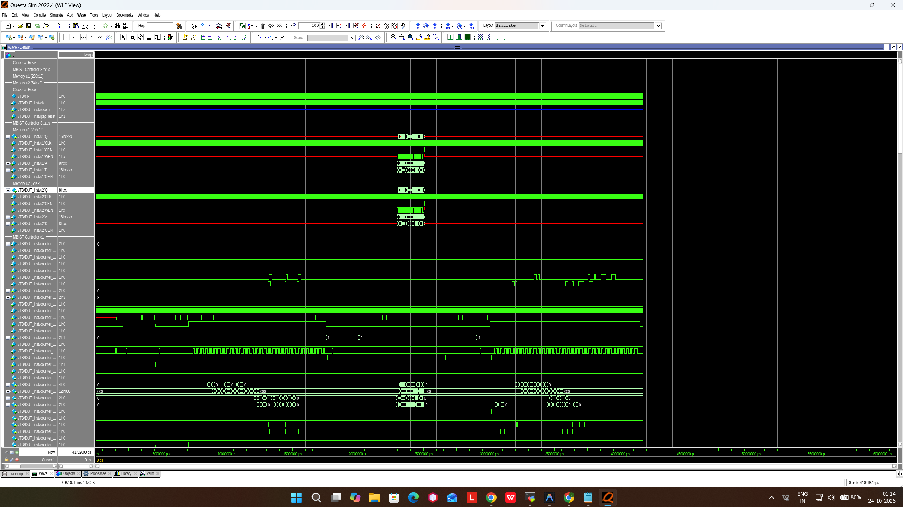
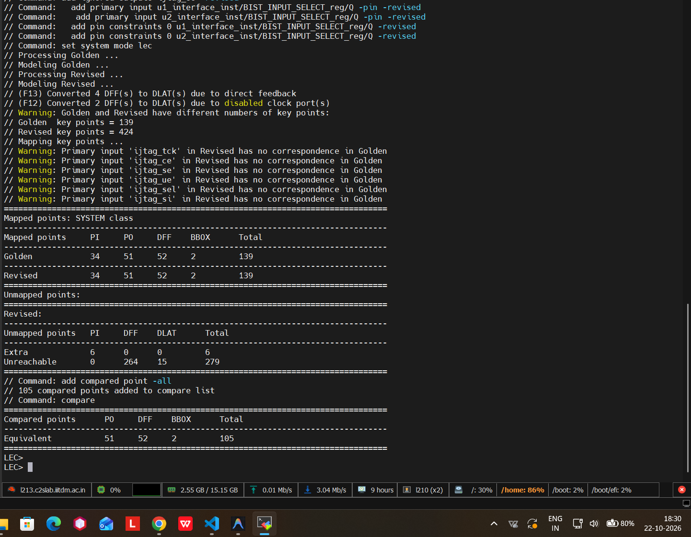
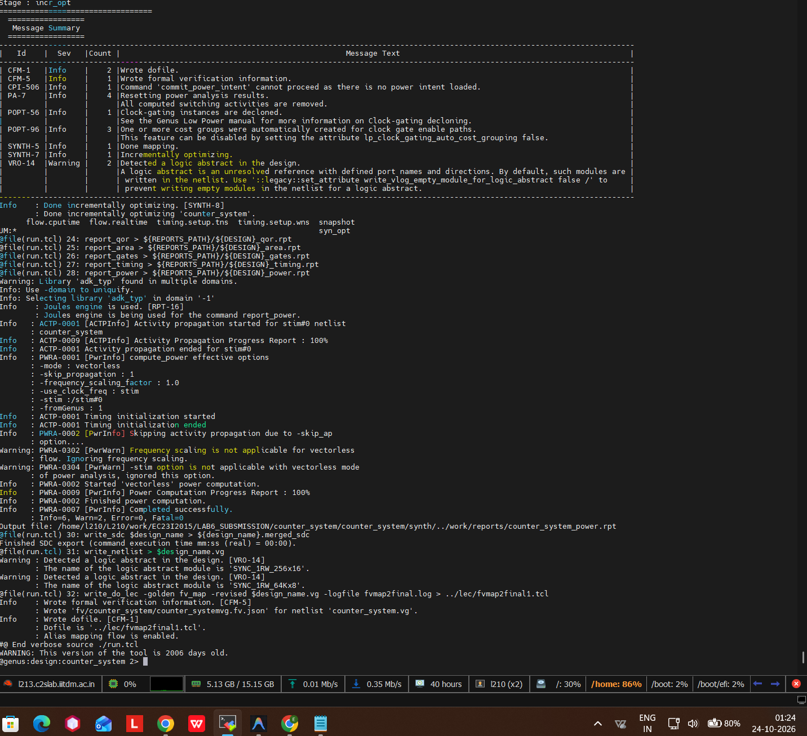
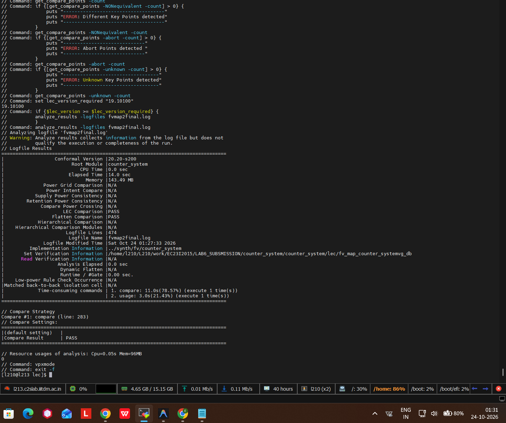

# Lab 6: Memory Built-In Self-Test (MBIST) Insertion, Synthesis, and Two-Stage Formal LEC Verification

## Overview

Modern VLSI Systems-on-Chip (SoCs) integrate dense embedded SRAM arrays. Because memories have unique physical defect modes (transition faults, coupling faults, address decoder faults, pattern-sensitive faults, and retention faults) that cannot be covered by standard scan ATPG, dedicated built-in test hardware—**Memory BIST (MBIST)**—is inserted at the RTL level.

This repository contains the complete implementation, scripts, reports, simulation waveforms, and formal equivalence verification files for **Lab 6 (Counter System Memory BIST)**.

### Target Architecture (`counter_system`)
- **LFSR Counter**: 8-bit pseudo-random counter (`u_counter_lfsr`)
- **Shift Register Counter**: 16-bit shift counter (`u_counter_shift`)
- **Embedded SRAM Macro `u1`**: `SYNC_1RW_256x16` (256 words $\times$ 16 bits)
- **Embedded SRAM Macro `u2`**: `SYNC_1RW_64Kx8` (65,536 words $\times$ 8 bits)

---

## Complete Verification Flow & Methodology

The design flow follows a 5-step industrial test methodology combining Siemens Tessent, Siemens QuestaSim, Cadence Genus, and Cadence Conformal LEC:

```
[ Original RTL ]
(counter_system.v)
       |
       |  (1) Tessent MBIST Insertion
       v
[ Post-MBIST RTL ]  <=================>  [ Original RTL ]
(BIST Controller,        Stage 1 LEC     (MBIST held in normal mode,
 Collars, IJTAG SIBs)    (mbist.do)       105/105 Points EQUIVALENT)
       |
       |  (2) Cadence Genus Synthesis (Clock Gating, POPT-56)
       v
[ Generic / Unmapped ]  <=============>  [ Post-MBIST RTL ]
    (fv_map.v.gz)        Stage 2A LEC     (PASS)
       |                (rtl2fvmap1.tcl)
       v
[ Final Gate Netlist ]  <=============>  [ Generic / Unmapped ]
(counter_system.vg)      Stage 2B LEC     (Formal guidance via CFM-5 json,
                        (fvmap2final1.tcl) PASS)
```

---

## Detailed Step Walkthrough

### 1. MBIST Insertion & Signoff Simulation (Siemens Tessent)
- **Working Directory:** `counter_system/mbist`
- **Execution Script:** `run_mbist_insertion`
- **Actions:**
  - Placed DFT context at RTL level: `set_context dft -rtl -design_id rtl1`.
  - Read standard cell library (`adk.tcelllib`) and memory TCD models (`SYNC_1RW_256x16`, `SYNC_1RW_64Kx8`).
  - Added primary clock: `add_clocks 0 clk -period 10.0ns` (100 MHz).
  - Executed DRC rules and generated DFT specification. Tessent generated BIST controller `c1`, wrapped memory interfaces with test collars, and added IJTAG IEEE 1687 SIB networks (`counter_system_rtl1_tessent_sib_1`, `counter_system_rtl1_tessent_sib_2`).
  - Generated and simulated signoff pattern suites:
    - `ICLNetwork`
    - `MemoryBist_P1`
    - `MemoryBist_ParallelRetentionTest_P1`
- **Result:** **`pass 3, fail 0`** (100% test pass rate).
- Converted synthesis file list using `create_mbist_filelist.pl` to produce `mbist_file_list`.


---

### 2. Signoff Simulation Waveform Inspection (Siemens QuestaSim)
- **Waveform Database:** `simulation_outdir/counter_system_rtl1.simulation_signoff/MemoryBist_P1.simulation/vsim.wlf`
- **Key Signals Verified:**
  - **Clock & Reset:** `clk`, `reset_n`, `ijtag_reset`.
  - **MBIST Controller Status:**
    - `MBISTPG_EN`: Controller active during test.
    - `COLLAR_EN`: Enables collar multiplexers to drive memory ports with test vectors.
    - `MBISTPG_DONE = 1`: Asserts high upon completing all test steps.
    - `MBISTPG_GO = 1`: Stays high throughout test, indicating **zero memory defects detected**.
  - **Memory Interfaces:** Observed algorithmic March write/read bursts with sequential address increments on instances `u1` and `u2`.



---

### 3. Stage 1 Formal Verification (Pre-MBIST vs. Post-MBIST RTL)
- **Working Directory:** `counter_system/lec`
- **Execution Script:** `mbist.do`
- **Objective:** Mathematically guarantee that inserting MBIST test controllers and collars **does not alter normal functional behavior in mission mode**.
- **Pin Constraints Applied:**
  ```tcl
  add pin constraints 0 scan_enable -both
  add pin constraints 0 scan_mode -both
  add pin constraints 0 ijtag_reset -revised
  add ignored outputs ijtag_so -revised
  add pin constraints 0 u1_interface_inst/BIST_INPUT_SELECT_reg/Q -revised
  add pin constraints 0 u2_interface_inst/BIST_INPUT_SELECT_reg/Q -revised
  ```
- **Result:** **105 out of 105 compared points EQUIVALENT** (51 POs, 52 DFFs, 2 BBOXs, 0 Non-EQ, 0 Abort).



---

### 4. Logic Synthesis with Low-Power Clock Gating (Cadence Genus)
- **Working Directory:** `counter_system/synth`
- **Execution Script:** `run.tcl`
- **Features Configured:**
  - Enabled Low-Power Clock Gating: `set_db lp_insert_clock_gating true`.
  - Added intermediate formal verification export after mapping:
    ```tcl
    syn_generic
    syn_map
    write_do_lec -golden rtl -revised fv_map -logfile rtl2map.log > ../lec/rtl2fvmap1.tcl
    ```
  - Incremental optimization & gate netlist export:
    ```tcl
    syn_opt
    write_sdc $design_name > ${design_name}.merged_sdc
    write_netlist > $design_name.vg
    write_do_lec -golden fv_map -revised $design_name.vg -logfile fvmap2final.log > ../lec/fvmap2final1.tcl
    ```
- **Outputs:**
  - Netlist: `counter_system.vg`
  - Constraints: `counter_system.merged_sdc`
  - Reports in `work/reports/`: `counter_system_area.rpt`, `counter_system_power.rpt`, `counter_system_timing.rpt`, `counter_system_gates.rpt`, `counter_system_qor.rpt`.



---

### 5. Stage 2 Formal Verification (Post-MBIST RTL vs. Gate Netlist)

#### The Problem: Why Direct RTL-to-Netlist Yielded 65 Non-Equivalent Points
When attempting an unassisted single-step equivalence check between the post-MBIST RTL and `counter_system.vg`:
- All 52 Primary Outputs passed.
- Both memory black boxes passed.
- **65 DFFs were flagged as NON-EQUIVALENT**.

**Root Cause:**
During synthesis, Cadence Genus performed aggressive sequential optimizations:
1. **Flop Merging:** Multiple state-machine control registers inside the Tessent MBIST controller (such as `EXECUTE_ADD_Y1_CMD_REG0_reg` and `EXECUTE_LOOP_CMD_REG1_reg`) have identical functional state transitions. Genus merged them to save area.
2. **Clock-Gating Decloning (`POPT-56`):** Clock nets were grouped and modified with clock-gating cells.
3. Without sequential mapping knowledge, standard Conformal LEC tries 1:1 name matching on removed flops and marks them as non-equivalent.

#### The Solution: Cadence Two-Stage Formal Verification Flow
The equivalence check is partitioned into two guided verification stages:

#### Stage 2A: Post-MBIST RTL to Intermediate Representation (`rtl2fvmap1.tcl`)
- Compares the post-MBIST RTL against the generic unmapped database (`fv_map.v.gz`).
- **Command:** `lec -XL -nogui -dofile rtl2fvmap1.tcl`
- **Result:** **PASS** (`Hierarchical Compare Result: PASS`).


#### Stage 2B: Intermediate Representation to Final Netlist (`fvmap2final1.tcl`)
- Compares `fv_map` against the final optimized gate netlist (`counter_system.vg`) using the formal verification JSON database (`counter_systemvg.fv.json`), which encodes all sequential register merges and clock-gating decloning rules.
- **Command:** `lec -XL -nogui -dofile fvmap2final1.tcl`
- **Result:** **PASS** (`| Compare Result | PASS`).



---

## Verification Artifacts & Deliverables Summary

| Step / Deliverable | Tool | Result | Key File / Artifact |
| :--- | :--- | :--- | :--- |
| **MBIST Insertion** | Siemens Tessent | 3/3 Tests PASS | `mbist/run_mbist_insertion.log` |
| **P1 March Test Waveform** | Siemens QuestaSim | Burst activity & GO=1 verified | `MemoryBist_P1/vsim.wlf` |
| **Stage 1 RTL LEC** | Cadence Conformal | 105/105 Points Equivalent | `lec/mbist.do`, `lec/mbist_lec.log` |
| **Logic Synthesis** | Cadence Genus | Zero setup violations, reports written | `synth/counter_system.vg`, `work/reports/` |
| **Stage 2A Formal LEC** | Cadence Conformal | PASS | `lec/rtl2fvmap1.tcl`, `lec/rtl2map.log` |
| **Stage 2B Formal LEC** | Cadence Conformal | PASS | `lec/fvmap2final1.tcl`, `lec/fvmap2final.log` |

---

## Directory Structure

```
lab6/
├── README.md                          # Comprehensive documentation of complete lab flow
├── lab6_final_report.pdf              # 12-page compiled formal laboratory report
├── lab6_final_report.tex              # LaTeX source code with embedded figures & tables
├── lab6_mbist_two_stage_lec.pdf       # Supplementary deep-dive report on two-stage LEC theory
├── lab6_mbist_two_stage_lec.tex       # LaTeX source code for two-stage LEC explanation
└── images/                            # Verification proof screenshots
    ├── mbist insertion.png            # Tessent signoff simulation (pass 3 fail 0)
    ├── waveform.png                   # QuestaSim P1 simulation waveform
    ├── stage1_lec_pass.png            # Stage 1 LEC 105/105 equivalent
    ├── lec pass.png                   # High-res copy of Stage 1 LEC
    ├── genus_run.png                  # Cadence Genus synthesis execution
    ├── 2A_First_stage lec.png         # Stage 2A LEC (RTL to fv_map) PASS
    └── 2A_second_stage_lec.png        # Stage 2B LEC (fv_map to netlist) PASS
```
